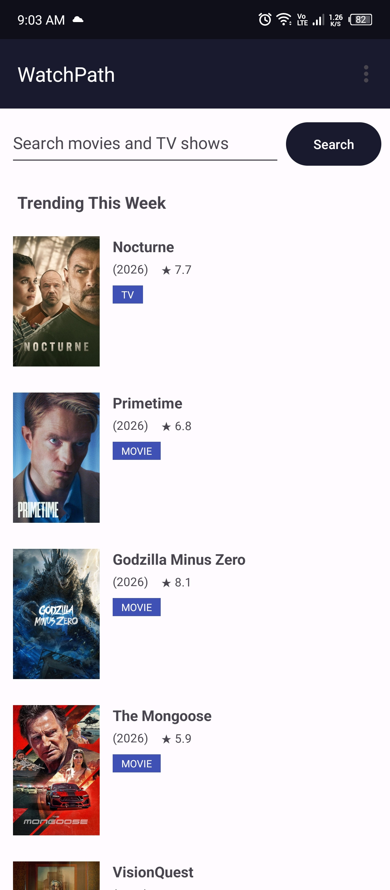
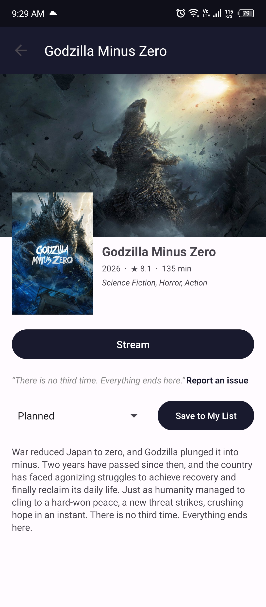
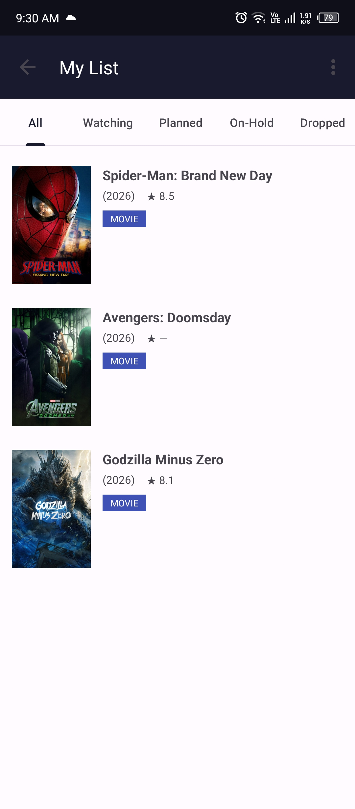
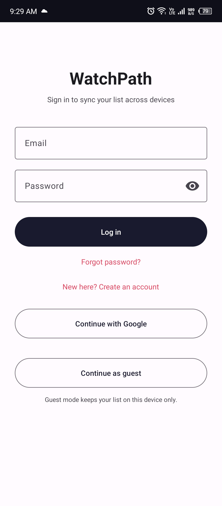
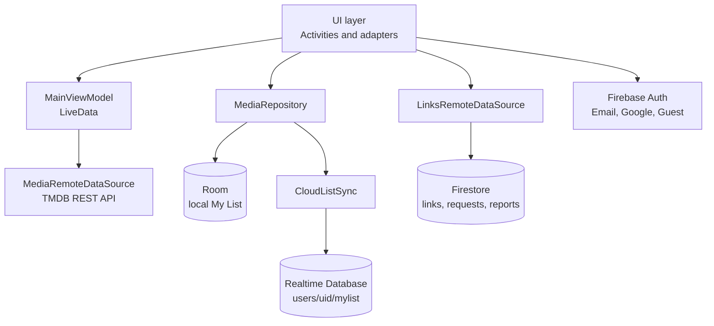

# WatchPath

**A movie and TV discovery app for Android.** Browse what's trending, search any title, keep a personal watch list that follows your account across devices, and request titles you can't find.

Built in Java for the *Advanced Programming Laboratory* course. Data comes from the TMDB API, with Room, Firebase Authentication, Cloud Firestore and Firebase Realtime Database behind it.


**[Download the latest APK (v1.1.0)](https://github.com/Maharab4120/WatchPath/releases/tag/v1.1.0)**

> **Author:** `Maharab Hossain` &nbsp;|&nbsp; **Roll:** `2307040` &nbsp;|&nbsp; **Course:** Advanced Programming Laboratory

---

## Screenshots

| Trending | Details | My List | Login |
|---|---|---|---|
|  |  |  |  |

---

## Features

**Discover**
- Trending titles of the week on launch
- Search for movies and TV shows, with debounced auto-search
- Infinite scroll for both trending and search results
- Swipe down to refresh
- Details screen with backdrop, poster, genres, tagline and overview

**My List**
- Save any title with a status: Planned, Watching, On-Hold, Dropped or Watched
- Filter your list by status with tabs
- Works offline: the list is stored locally in Room

**Accounts: two modes**
- **Guest mode:** no sign-up, the list stays on the device
- **Account mode:** email and password with email verification, password reset, or one-tap Google sign-in
- **Cloud sync:** your list follows your account to any device, and guest items are merged into your account when you log in

**Community**
- Request a title that has no stream link yet. Each user can request a title once, and the request count is shared by everyone
- Report a broken or wrong link
- A background check tells you with a notification when a saved title becomes available

**Polish**
- Light and dark themes
- Loading, empty and error states
- Lifecycle logging under one Logcat tag for demos (`WatchPathLifecycle`)

---

## Tech stack

| Area | Technology |
|---|---|
| Language | Java 8, Android SDK (min 24, target 33, compile 34) |
| UI | Material Components, ViewBinding, RecyclerView, SwipeRefreshLayout |
| Architecture | MVVM for the main screen (ViewModel + LiveData), repository layer |
| Local storage | Room (SQLite) |
| Networking | TMDB REST API, `NetworkUtils` over `HttpURLConnection`, `org.json` |
| Images | Custom `ImageLoader` with an in-memory `LruCache` |
| Auth | Firebase Authentication: email/password, Google (Credential Manager), anonymous guests |
| Cloud data | Cloud Firestore (links, requests, reports), Realtime Database (per-user My List) |
| Android components | Service, BroadcastReceivers, ContentProvider, notifications |
| Tests | JUnit 4 unit tests |

---

## Architecture



### Why three data stores?

| Store | What it holds | Why it fits |
|---|---|---|
| **Room** | The My List on this device | Fast, works offline, and is the single source the UI reads |
| **Realtime Database** | One user's My List in the cloud | A small JSON tree per user that is easy to sync and has built-in offline caching |
| **Firestore** | Shared data: stream links, request counts, reports | Needs transactions and security rules that apply across users |

### My List sync

1. Every save or delete goes through `MediaRepository`, which writes to Room and then to Realtime Database. In guest mode the cloud write is skipped.
2. On login and whenever My List opens, `CloudListSync.syncNow()` downloads the account's list into Room. If the same title exists in both places, the cloud copy wins.
3. On an account's first sync, items that exist only locally (saved as a guest) are uploaded. On later syncs, local-only items are treated as deleted elsewhere and removed.
4. On logout, the local list is cleared. The cloud copy stays, and the next login downloads it again.

If the cloud read fails (for example, no internet), nothing is changed, so a failed sync can never delete data.

### Request deduplication

Requesting a title runs in a **Firestore transaction**. It reads the user's marker document and, only if it doesn't exist, writes the marker and increments the counter in the same commit. The security rules repeat the check on the server, so a modified client can't count twice either.

---

## Project structure

```
app/src/main/java/com/watchpath/app/
├── LoginActivity.java          Entry screen: guest, email, Google
├── MainActivity.java           Trending and search, account menu
├── WatchPathApp.java           Application class, Firebase setup
├── data/
│   ├── MediaRepository.java    Single write path for My List
│   ├── local/                  Room: entity, DAO, database, ContentProvider
│   └── remote/                 TMDB, Firestore links, CloudListSync, DTOs
├── receiver/                   ConnectivityReceiver, RequestsReadyReceiver
├── service/                    PendingRequestService
├── ui/
│   ├── BaseActivity.java       Lifecycle logging for every activity
│   ├── details/                Details screen
│   ├── mylist/                 My List screen and adapter
│   └── search/                 MainViewModel and results adapter
└── util/                       AuthHelper, ImageLoader, NetworkUtils, notifications

firestore.rules                 Firestore security rules
database.rules.json             Realtime Database security rules
```

---

## Course syllabus mapping

| Week | Topic | Where it appears in WatchPath |
|---|---|---|
| 8 | Activity lifecycle, view binding, intents | `BaseActivity` logs every lifecycle callback. Explicit intents move between screens, and an implicit `ACTION_VIEW` intent opens links. ViewBinding is used throughout. |
| 9 | RecyclerView, adapters, custom items | `MediaAdapter` and `MediaEntityAdapter` with a custom `item_media` layout, appended pages, and a custom `ImageLoader` with an LruCache |
| 10 | Service, receivers, ContentProvider, permissions | `PendingRequestService` posts notifications. `ConnectivityReceiver` is registered at runtime and `RequestsReadyReceiver` is declared in the manifest. `MediaContentProvider` exposes My List read-only, and `POST_NOTIFICATIONS` is requested at runtime. |
| 11 | Networking, JSON, databases, Firebase | TMDB calls parsed with `org.json`. Room for local data. Firebase Auth, Firestore and Realtime Database. |

---

## Security notes

- The **TMDB API key** is not in the repository. It is read from `local.properties` at build time.
- **Firestore rules:** stream links are read-only for the app. Requests can only be created through the per-user transaction. Reports can only be created by a signed-in user (guests count) and can't be edited afterwards.
- **Realtime Database rules:** each user can only read and write `users/{their own uid}`, and every list item must contain its required fields.
- Release signing keys are never committed (`*.jks` is not tracked).
- `google-services.json` contains Firebase client configuration, which is not a secret. Access is controlled by the rules above.

---

## Run it yourself

### Quick way

Download the APK from the [latest release](https://github.com/Maharab4120/WatchPath/releases/tag/v1.1.0), open it on an Android 7.0+ device, and allow "Install unknown apps" if asked.

### From source

1. **Clone** the repository and open it in Android Studio.
2. **TMDB key:** create a free API key at [themoviedb.org](https://www.themoviedb.org/settings/api) and add this line to `local.properties`:
   ```
   TMDB_API_KEY=your_key_here
   ```
3. **Firebase** (needed only if you want your own backend instead of the author's):
   1. Create a Firebase project and add an Android app with the package name `com.watchpath.app`.
   2. Replace `app/google-services.json` with your own file.
   3. In **Authentication**, enable **Email/Password** and **Google**. For Google sign-in, add your debug and release **SHA-1** fingerprints in Project settings, then re-download `google-services.json`.
   4. Create a **Firestore** database and publish `firestore.rules`.
   5. Create a **Realtime Database** and publish `database.rules.json`, then re-download `google-services.json` so it contains the database URL.
4. **Run** the app on a device or emulator.

### Stream links data (Firestore)

Add documents to `movie_links` or `tv_links`, using the TMDB id as the document id, with a `links` field that holds a list of URLs. The app tries them in order.

### Run the tests

```bash
./gradlew testDebugUnitTest
```


---

## Credits

This product uses the TMDB API but is not endorsed or certified by TMDB.

Movie and TV data and images are provided by [The Movie Database (TMDB)](https://www.themoviedb.org/).
